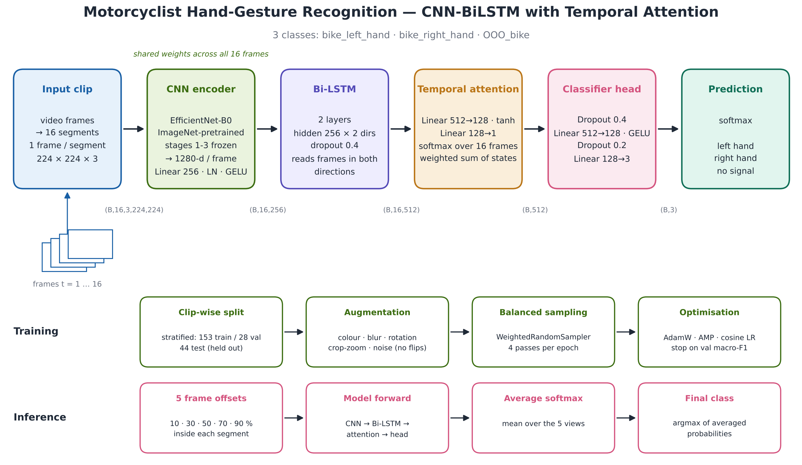
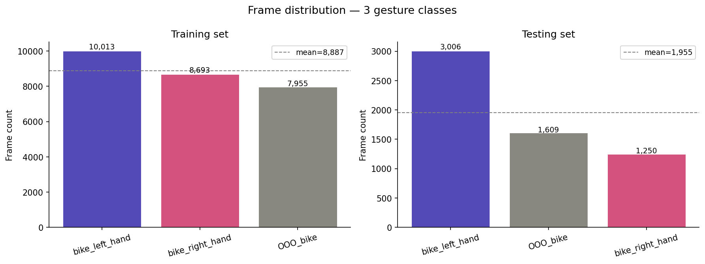
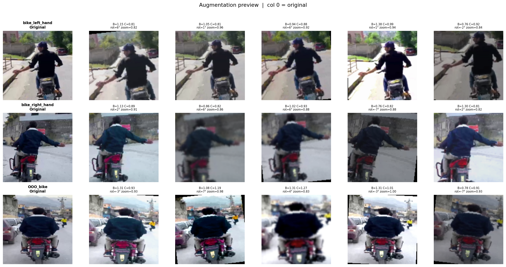
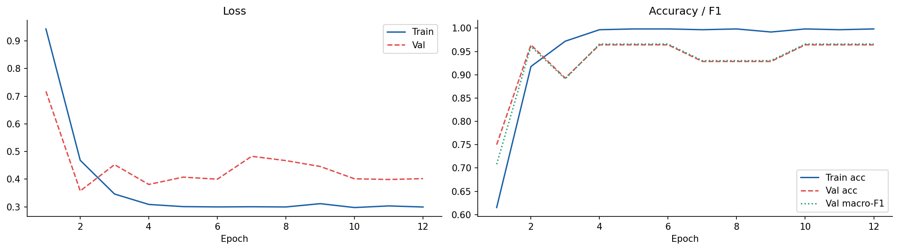
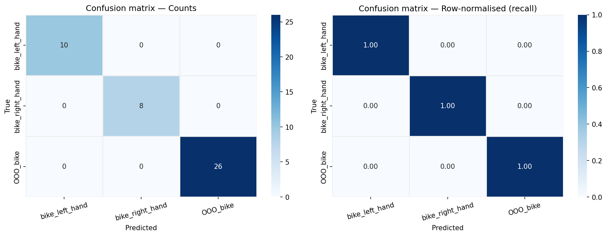
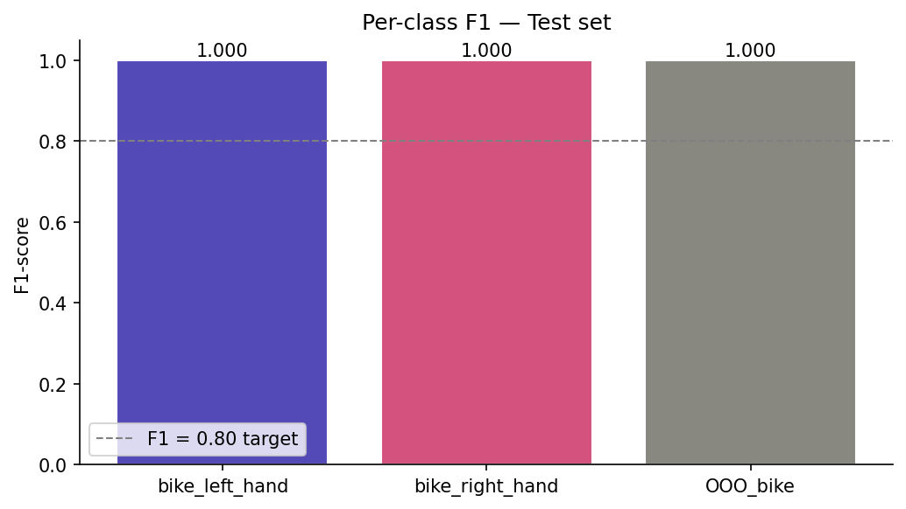

# Motorcyclist Hand-Signal Recognition from Video Using EfficientNet-B0 and Bi-LSTM

**Video-Based Motorcyclist Hand-Gesture Classification for Autonomous Vehicle Safety**

An autonomous vehicle has to understand what the riders around it are about to do. This project classifies
short video clips of a motorcyclist into **three hand-signal classes** using an
**EfficientNet-B0 → Bi-LSTM → Temporal Attention** network, trained on Kaggle (Tesla T4).

| Class | Meaning |
|---|---|
| `bike_left_hand` | Rider signals a left turn with the hand |
| `bike_right_hand` | Rider signals a right turn with the hand |
| `OOO_bike` | No signal (rider/bike without a hand gesture) |

> **Test result: 44 / 44 clips correct (accuracy 1.00, macro-F1 1.00)** on the held-out `Testing` folder.
> See [Limitations](#limitations-and-honest-notes) before drawing conclusions from this number.

**Contents:** [Architecture](#architecture) · [Dataset](#dataset) · [Method](#method) · [Results](#results) · [Repository structure](#repository-structure) · [Reproduce](#reproduce-on-kaggle) · [Inference](#inference) · [Limitations](#limitations-and-honest-notes)

---

## Architecture



Every frame of a 16-frame clip goes through the same EfficientNet-B0 encoder. A 2-layer Bi-LSTM reads the
resulting feature sequence in both directions, temporal attention weights the frames that matter most, and a small
MLP head outputs the 3 class probabilities. A scalable version is available as [`architecture.svg`](architecture.svg).

---

## Dataset

[`iamiqbalshigri/motorcyclist-hand-gesture`](https://www.kaggle.com/datasets/iamiqbalshigri/motorcyclist-hand-gesture)
→ `HandGesture_Dataset/{Training,Testing}`. Each class folder contains clip folders, and each clip folder contains consecutive frames.
The dataset is **not** included in this repository.

| Split | Class | Clips | Frames | Avg frames / clip |
|---|---|---:|---:|---:|
| Training | bike_left_hand | 57 | 10,013 | 176 |
| Training | bike_right_hand | 54 | 8,693 | 161 |
| Training | OOO_bike | 70 | 7,955 | 114 |
| Testing | bike_left_hand | 10 | 3,006 | 301 |
| Testing | bike_right_hand | 8 | 1,250 | 156 |
| Testing | OOO_bike | 26 | 1,609 | 62 |

Training clips are split **clip-wise and stratified** into train (153 clips) / validation (28 clips).
The official `Testing` folder (44 clips) is used **only once**, for the final evaluation.



---

## Method

- **Frame sampling:** each clip is divided into 16 equal segments; training picks a random frame per segment, evaluation picks a fixed one. The model sees the *whole* gesture, not just a short window.
- **Backbone:** EfficientNet-B0 (ImageNet-pretrained, first 3 stages frozen) → 1280-d → Linear 256 + LayerNorm + GELU + Dropout, shared across all frames.
- **Temporal model:** 2-layer **bidirectional LSTM** (hidden 256 per direction) followed by **temporal attention** over the 16 time steps.
- **Augmentation (clip-consistent, no flips):** brightness, contrast, saturation, small hue shift, blur, rotation (±8°), random crop-zoom, Gaussian noise. Parameters are sampled once per clip so temporal coherence is preserved. **No horizontal flip**, because it would turn *left* into *right*.
- **Class imbalance:** handled once, through a `WeightedRandomSampler` (4 balanced passes over the training clips per epoch).
- **Optimisation:** AdamW, differential learning rates (backbone 1e-4, head 5e-4), 1-epoch warm-up + cosine decay, label smoothing 0.1, gradient clipping, mixed precision (AMP). Early stopping on validation macro-F1 (ties broken by validation loss).
- **Inference:** each clip is scored from **5 frame offsets** (10 %, 30 %, 50 %, 70 %, 90 % inside each segment) and the softmax probabilities are averaged.



Model size: **7.10 M parameters** (7.08 M trainable).

---

## Results

### Training run

| Setting | Value |
|---|---|
| Hardware | Kaggle Tesla T4, mixed precision |
| Batch size / epochs / patience | 32 / 15 max / 8 |
| Stopped at | epoch 12 (early stopping) |
| Best checkpoint | epoch 4 — validation accuracy 0.9643, validation macro-F1 0.9659 |



Training accuracy reaches about 0.998 after only a few epochs while validation stays around 0.93–0.96, and validation loss
stops improving after epoch 2. The data is small (153 training clips), so the model fits it quickly. Training accuracy is measured
*during* each epoch with augmentation and dropout on, whereas validation is a clean eval-mode pass on only 28 clips, which is also why
validation can look higher than training in the first epochs.

### Test set (44 clips, held out)

| Class | Precision | Recall | F1 | Support |
|---|---:|---:|---:|---:|
| bike_left_hand | 1.000 | 1.000 | 1.000 | 10 |
| bike_right_hand | 1.000 | 1.000 | 1.000 | 8 |
| OOO_bike | 1.000 | 1.000 | 1.000 | 26 |
| **Accuracy / macro-F1** | | | **1.000 / 1.000** | 44 |

Single-view and 5-view inference both reach 100 %. Mean confidence on the correct class:
`bike_left_hand` 0.951 · `bike_right_hand` 0.938 · `OOO_bike` 0.902.

### Confusion matrix



### Per-class F1



---

## Repository structure

```
.
├── README.md
├── architecture.png                  # model + training/inference pipeline diagram
├── architecture.svg
├── notebook/
│   └── motorcyclist-hand-gesture-3class-kaggle-v2.ipynb   # full training + evaluation
├── model/
│   └── best_model.pt                 # trained weights + class names
└── assets/
    ├── 01_frame_distribution.png
    ├── 03_augmentation_preview.png
    ├── 04_training_curves.png
    ├── 05_confusion_matrix.png
    └── 06_per_class_f1.png
```

---

## Reproduce on Kaggle

1. Create a new Kaggle notebook and import `notebook/motorcyclist-hand-gesture-3class-kaggle-v2.ipynb`.
2. **Add Input** → the dataset linked above.
3. Settings: **Accelerator = GPU (T4)**, **Internet = ON** (the pretrained backbone weights are downloaded once).
4. **Run All.** Results are written to `/kaggle/working/outputs`.

Key hyper-parameters live in the `Config` class (Cell 3): `FRAMES_PER_CLIP=16`, `IMG_SIZE=224`, `BATCH_SIZE=32`,
`EPOCHS=15`, `EPOCH_MULT=4`, `PATIENCE=8`, `SEED=42`.

---

## Inference

The checkpoint stores the weights and the class names. Copy the `CNNEncoder`, `TemporalAttention` and `CNNBiLSTM` classes from
Cell 11 of the notebook, then:

```python
import torch

ckpt  = torch.load("model/best_model.pt", map_location="cpu")
model = CNNBiLSTM(num_classes=3, pretrained=False)
model.load_state_dict(ckpt["state"])
model.eval()

print(ckpt["classes"])   # ['bike_left_hand', 'bike_right_hand', 'OOO_bike']
```

Inside the notebook, `predict_clip(sorted(glob("path/to/clip_folder/*.png")))` classifies any folder of frames using the 5-view averaging.
Input to the model is a tensor of shape `(batch, 16, 3, 224, 224)`, normalised with the ImageNet mean/std.

---

## Limitations and honest notes

- **Small test set.** 44 clips (10 left, 8 right). A perfect 44/44 is consistent with a true accuracy of roughly 92–100 %; it is not proof of perfection.
- **Same-source data.** The test clips probably share recording conditions (riders, locations, cameras, lighting) with the training clips. Performance on new riders, camera angles, night scenes or other regional hand-signal conventions is **untested**.
- **Three classes only.** Other gestures (stop, slow down, etc.) are not recognised and would be forced into one of the three classes.
- **Not a safety-certified system.** It must not be used as the sole input for any real driving decision.

## Acknowledgements

Dataset by [iamiqbalshigri](https://www.kaggle.com/iamiqbalshigri) on Kaggle. Backbone weights from torchvision (ImageNet).
